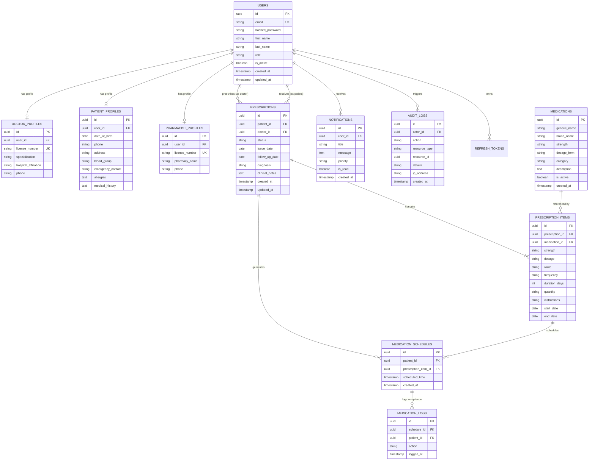

# ArogyaNova — Database Management System (DBMS) Specification & ER Diagram

> **Database Engine:** PostgreSQL (Production / Docker) / SQLite+aiosqlite (Local Dev)  
> **ORM:** SQLAlchemy 2.0 (AsyncIO)  
> **Migration Tool:** Alembic  
> **Normalization Standard:** Third Normal Form (3NF)

---

## 1. Entity-Relationship (ER) Diagram

---

## 2. Relational Database Normalization Analysis

### First Normal Form (1NF)
- **Elimination of Repeating Groups:** Rather than storing comma-separated medicines inside `PRESCRIPTIONS`, a separate normalized table `PRESCRIPTION_ITEMS` holds atomic medication rows.
- **Atomicity:** All attributes store single, indivisible values (e.g. `first_name`, `last_name`, `strength`, `duration_days`).
- **Primary Keys:** Every entity contains a unique `UUID` primary key (`id`).

### Second Normal Form (2NF)
- Meets all 1NF requirements.
- **Full Functional Dependency:** In `PRESCRIPTION_ITEMS`, every attribute depends entirely on the primary key `id`, with no partial dependency on composite candidate keys.
- Role-specific attributes are partitioned into profile tables (`DOCTOR_PROFILES`, `PATIENT_PROFILES`, `PHARMACIST_PROFILES`) rather than causing null-padded columns in a monolithic `USERS` table.

### Third Normal Form (3NF)
- Meets all 2NF requirements.
- **Transitive Dependency Elimination:** In `PRESCRIPTION_ITEMS`, rather than copying `category`, `dosage_form`, or `manufacturer` from `MEDICATIONS`, it holds a foreign key `medication_id`. Any update to drug formulations propagates automatically without data anomalies.

---

## 3. ACID Properties & Transaction Boundaries

- **Atomicity:** When a doctor finalizes a prescription, the creation of the prescription items, status transition, and schedule generation occur inside an explicit `async with session.begin():` block. If any insert fails, the entire transaction rolls back cleanly, leaving zero partial prescription records in the database.
- **Consistency:** Enforced via database foreign keys (`ON DELETE CASCADE`), unique constraints (`users.email`, `doctor_profiles.license_number`), and check constraints (`duration_days > 0`).
- **Isolation:** Managed via connection pool isolation level (`READ COMMITTED`), preventing dirty reads during concurrent patient and doctor requests.
- **Durability:** Committed transactions write to write-ahead logs (WAL) in PostgreSQL, persisting data across server restarts.
