# ArogyaNova — Computer Networks Architecture & Integration

This document outlines the computer networks principles, protocol stack, and communication lifecycles implemented in ArogyaNova.

---

## 1. Request Flow Architecture

```mermaid
flowchart LR
    subgraph Client["Presentation Layer (Client Browser)"]
        UI["React SPA (Port 5173)"]
        Axios["Axios HTTP Client"]
    end

    subgraph Network["Network Protocols"]
        TLS["TLS 1.3 Encryption"]
        TCP["TCP Connection (Port 443 / 8000)"]
        IP["IPv4 / IPv6 Routing"]
    end

    subgraph Server["Application Server (FastAPI)"]
        FastAPI["Uvicorn ASGI + FastAPI"]
        CORS["CORS Middleware"]
        RateLimit["SlowAPI Rate Limiter"]
        Router["API Routing (/api/v1)"]
    end

    subgraph DataTier["Data Persistence Tier"]
        Pool["SQLAlchemy Async Connection Pool"]
        Postgres[("PostgreSQL Server (Port 5432)")]
    end

    UI --> Axios
    Axios --> TLS
    TLS --> TCP
    TCP --> IP
    IP --> FastAPI
    FastAPI --> CORS
    CORS --> RateLimit
    RateLimit --> Router
    Router --> Pool
    Pool --> Postgres
```

---

## 2. OSI & TCP/IP Protocol Stack Mapping

| Layer (TCP/IP) | Protocol Used in ArogyaNova | Responsibility in Application |
|---|---|---|
| **Application Layer** | **HTTP/1.1 & HTTP/2 (HTTPS)** | RESTful API endpoints (`/api/v1/*`), JSON request/response bodies, MIME content types (`application/json`, `multipart/form-data` for OCR). |
| **Transport Security** | **TLS 1.3** | End-to-end cryptographic confidentiality and data integrity between React browser client and FastAPI server. Prevents eavesdropping on clinical prescription payloads. |
| **Transport Layer** | **TCP** | Reliable, connection-oriented, sequenced stream transmission between browser, reverse proxy, and database connection pool. |
| **Internet Layer** | **IP (IPv4 / IPv6)** | Packet addressing and host-to-host routing across networks. |

---

## 3. Network Security & Performance Configurations

### A. Cross-Origin Resource Sharing (CORS)
Configured in `app/main.py` via `CORSMiddleware`:
- Strict origin allowlist (`settings.cors_origins_list`, e.g. `http://localhost:5173`).
- `allow_credentials=True` permits transmitting secure `HttpOnly` session and JWT cookies.
- Prevents cross-site script request injection from unauthorized third-party origins.

### B. Transport Security Headers
Every HTTP response emits standard defense-in-depth headers:
- `X-Content-Type-Options: nosniff`: Prevents MIME-confusion sniffing attacks.
- `X-Frame-Options: DENY`: Prevents UI redressing and clickjacking.
- `Referrer-Policy: strict-origin-when-cross-origin`: Restricts URL leakages in external links.

### C. Rate Limiting (DoS Mitigation)
Integrated via SlowAPI (`slowapi.Limiter`) using client IP address:
- Sensitive authentication routes (`/api/v1/auth/login`) are capped to prevent brute-force dictionary attacks.
- Global API calls capped at 60 requests/minute per client IP. Returns `HTTP 429 Too Many Requests` when exceeded.

### D. Database Connection Pooling
`app/db/database.py` manages an asynchronous connection pool (`pool_size=10`, `max_overflow=20`):
- Avoids the high TCP 3-way handshake overhead on every incoming HTTP request.
- Recycles persistent connections, executes pre-ping health probes (`pool_pre_ping=True`), and limits concurrent connection pressure on PostgreSQL.
