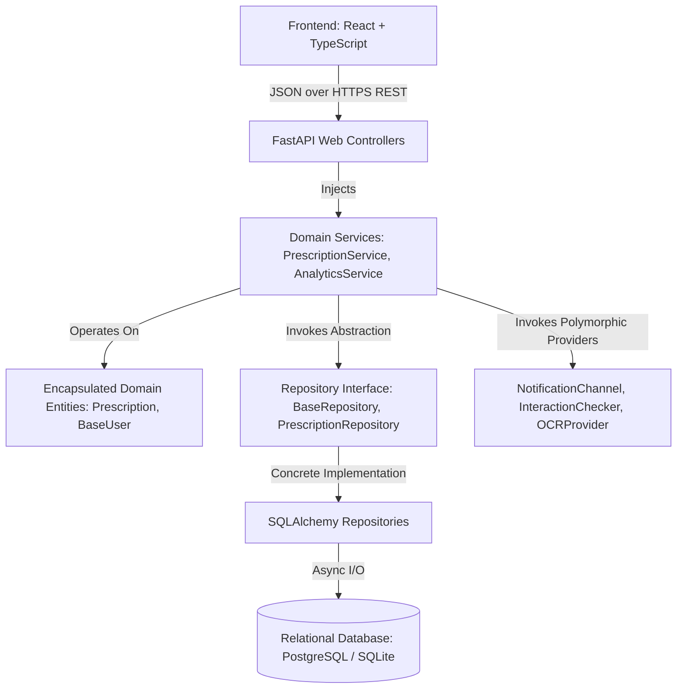
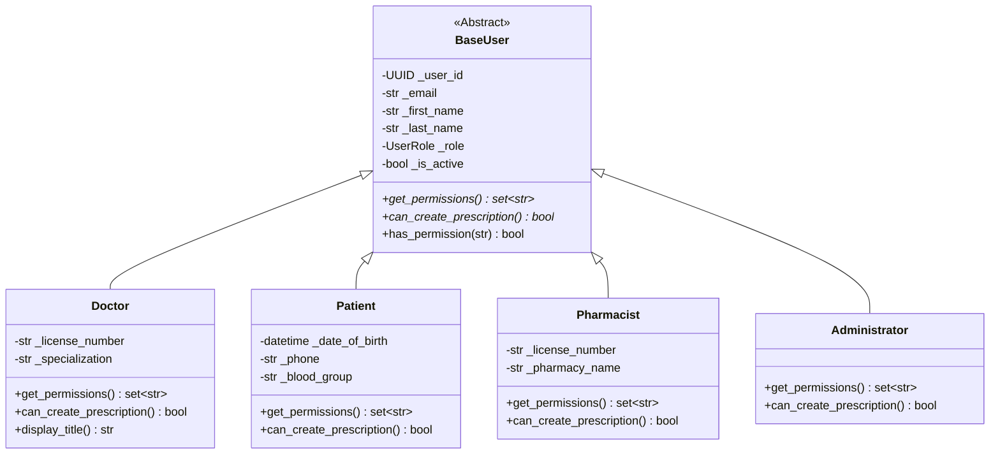

# ArogyaNova — Object-Oriented Methodologies (OOM) Academic Specification

> **Course:** Object-Oriented Methodologies (OOM)  
> **System Name:** ArogyaNova — Intelligent Prescription Management System  
> **Architecture:** Clean Layered Architecture (Domain, Repositories, Services, API, Persistence)

---

## 1. Executive Summary & Viva Defense Guide

ArogyaNova is designed specifically to exhibit genuine Object-Oriented Software Design, avoiding the common pitfalls of procedural "anemic models" and god classes. Business rules, validation boundaries, and state machines reside strictly within domain entity classes and polymorphic services.



---

## 2. Demonstration of the Four Pillars of OOP

### A. Encapsulation (Information Hiding & Invariant Protection)

Encapsulation ensures that an object maintains strict control over its internal state, preventing unauthorized or invalid state transitions from external components.

- **Class Reference:** `app.domain.prescription.Prescription` (`app/domain/prescription.py`)
- **Protected Attributes:**  
  `_prescription_id`, `_patient_id`, `_doctor_id`, `_status`, `_items`, `_issue_date`, `_updated_at`
- **Exposed Read-Only Properties:**  
  `status`, `items`, `patient_id`, `doctor_id`, `is_editable`
- **Controlled Mutator Methods:**
  - `add_item(item: PrescriptionItem)`: Enforces that items can **only** be added when status is `PrescriptionStatus.DRAFT`. Attempting to add an item to an active or cancelled prescription immediately raises a `DomainError`.
  - `remove_item(item_id: UUID)`: Ensures a prescription cannot be stripped of all medications.
  - `finalize(actor: BaseUser)`: Validates that only an active `Doctor` can finalize the draft, ensures that at least one medication item exists, and atomically transitions status from `DRAFT` to `ACTIVE`.
  - `cancel(actor: BaseUser, reason: str)`: Enforces that completed or expired prescriptions cannot be cancelled.

```python
# Code Reference: app/domain/prescription.py
class Prescription:
    def finalize(self, actor: BaseUser) -> None:
        if not actor.has_permission("prescription:finalize"):
            raise AuthorizationError("Only authorized prescribers may finalize prescriptions.")
        if self._status != PrescriptionStatus.DRAFT:
            raise StateTransitionError(f"Cannot finalize prescription in status '{self._status.value}'.")
        if not self._items:
            raise ValidationError("Prescription must contain at least one medication item.")
        self._status = PrescriptionStatus.ACTIVE
        self._updated_at = datetime.now(timezone.utc)
```

---

### B. Abstraction (Contracts & Decoupled Interfaces)

Abstraction separates **what** an operation does from **how** it is executed, exposing clean interfaces while hiding complex database or network mechanisms.

- **Abstract Base Classes:**
  1. `app.domain.base_user.BaseUser` (`app/domain/base_user.py`): Defines common identity and enforces that all derived role classes implement `get_permissions() -> set[str]` and `can_create_prescription() -> bool`.
  2. `app.repositories.base.BaseRepository[T]` (`app/repositories/base.py`): Generic abstract repository defining CRUD contracts (`get_by_id`, `list_all`, `create`, `update`, `delete`).
  3. `app.domain.notifications.NotificationChannel` (`app/domain/notifications.py`): Abstract notification interface with `async send(notification: Notification) -> bool`.
  4. `app.domain.ai_providers.InteractionChecker` (`app/domain/ai_providers.py`): Abstract interface defining `async check(medicines: list[str]) -> InteractionCheckResult`.
  5. `app.domain.ai_providers.OCRProvider` (`app/domain/ai_providers.py`): Abstract interface for optical character recognition.

---

### C. Inheritance (Role Hierarchy & Code Reuse)

Inheritance models an `is-a` relationship. Common user attributes (id, email, password hash, name, active status, timestamps) are inherited from `BaseUser`, while specialized attributes and behaviors are partitioned into subclasses.



---

### D. Polymorphism (Interchangeable Runtime Behaviors)

Polymorphism allows different concrete implementations to be invoked transparently through their shared abstract contract.

#### Example 1: Notification Dispatch
`NotificationService` takes a collection of `NotificationChannel` instances. Calling `dispatch(notification)` polymorphically routes messages across:
- `InAppNotificationChannel`: Persists in-app alert into database.
- `EmailNotificationChannel`: Dispatches email payload.
- `SMSNotificationChannel`: Formats and sends critical SMS alert.

#### Example 2: AI & Clinical Decision Support
- `LocalInteractionChecker`: Evaluates combinations against an internal pharmacological rules dataset.
- `UnavailableInteractionChecker`: Returns a transparent, non-fictitious unavailable status when network/provider is offline.
- `LocalOCRProvider` vs `UnavailableOCRProvider`: Safe fallback when OCR dependencies are unconfigured.

---

### E. Composition & Associations

- **Composition:** `Prescription` **has-a** collection of `PrescriptionItem` objects. A prescription item cannot exist independently of its parent prescription.
- **Aggregation / Association:** A `Prescription` associates with a `Patient` (the recipient) and a `Doctor` (the prescriber), and references `Medication` entities from the catalogue.
- **Dependency Injection:** `PrescriptionService` receives `PrescriptionRepository` via its constructor (`__init__(self, repo: PrescriptionRepository)`), fully decoupling business logic from the persistence framework.

---

## 3. SOLID Principles Applied in ArogyaNova

| Principle | Implementation in Codebase |
|---|---|
| **S — Single Responsibility** | `Prescription` only handles state machine transitions and items; `SQLAlchemyPrescriptionRepository` only handles SQL queries; `PrescriptionService` orchestrates workflows; FastAPI route handlers only parse HTTP requests and format responses. |
| **O — Open/Closed** | New notification channels (e.g. `WhatsAppNotificationChannel`) or ML interaction models can be added by implementing the abstract base class without modifying existing service code. |
| **L — Liskov Substitution** | Any subclass of `BaseUser` (`Doctor`, `Patient`, `Pharmacist`, `Administrator`) or `BaseRepository` can substitute for its base class without breaking calling services. |
| **I — Interface Segregation** | Clients depend only on focused interfaces: `PrescriptionRepository` exposes only prescription methods; `UserRepository` exposes only user operations. |
| **D — Dependency Inversion** | Domain services and API controllers depend on abstract interfaces (`PrescriptionRepository`, `InteractionChecker`) rather than concrete database sessions or external APIs. |
