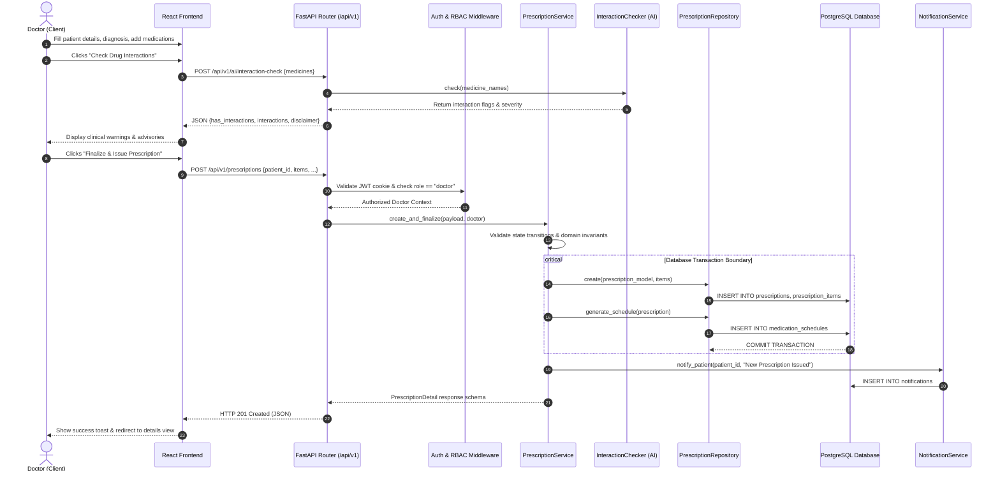
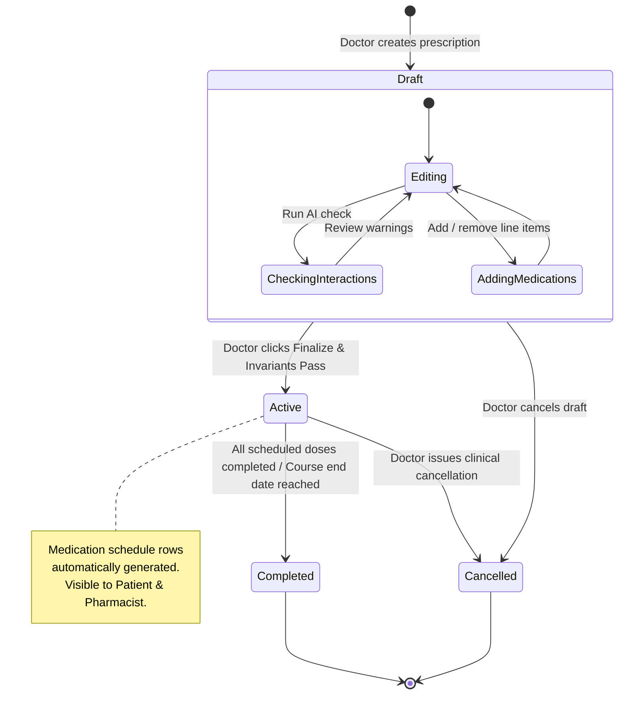

# ArogyaNova — Sequence & Activity Diagrams

## 1. Sequence Diagram: Prescription Creation Lifecycle

This sequence diagram illustrates the complete end-to-end flow across Computer Networks layers and backend architecture when a Doctor authors, checks interactions, and finalizes a prescription.

---

## 2. Activity Diagram: Prescription State Machine & Workflow

